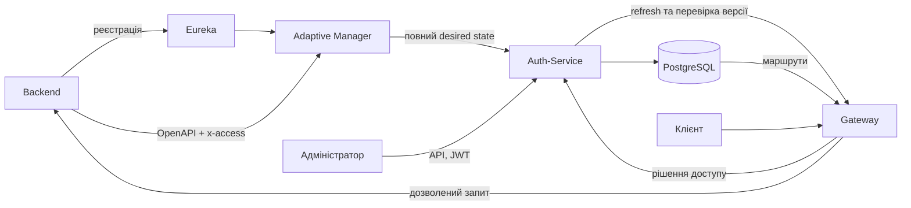

# Adaptive Gateway: запуск у IntelliJ IDEA та робота із системою

Актуальна інструкція після реалізації автоматичної реєстрації, permissions, адміністративних policies і централізованого Swagger. Система запускається на чистій PostgreSQL **без імпорту даних БКР**. Для звичайного запуску PowerShell, curl і Python не потрібні.

## 1. Перший запуск

Потрібні **JDK 21**, IntelliJ IDEA з підтримкою Java/Kotlin/Maven і запущена PostgreSQL. Перевірений сервер БД — PostgreSQL 18. Зовнішня БД залишається єдиною окремою передумовою; усі Java-компоненти запускаються з IDEA.

1. Відкрийте **кореневий `pom.xml`** як Maven-проєкт. Дочекайтеся імпорту залежностей. У Project SDK виберіть JDK 21. Кореневий Maven-проєкт включає п'ять основних модулів.
2. Через pgAdmin або Database console у вашій IDEA створіть **порожню БД `adaptive_gateway`**. Наприклад, SQL `CREATE DATABASE adaptive_gateway;`, виконаний у з'єднанні з БД `postgres`. Користувач БД повинен мати право створювати схему й таблиці всередині нової бази.
3. В IDEA скопіюйте `config/local.properties.example` у **`config/local.properties`**. Укажіть адресу БД, користувача, пароль PostgreSQL, логін і пароль першого адміністратора. Пароль адміністратора — від 12 символів. Цей файл виключений із Git.
4. У списку Run configurations використайте збережені конфігурації з `.run/`: **1 - Eureka → 2 - Auth → 3 - Gateway → 4 - Demo service → 5 - Adaptive Manager**. Після Auth дочекайтеся завершення запуску. Він створить схему, виконає міграції та створить адміністратора. Решту можна запускати після цього.
5. Дочекайтеся реєстрації в Eureka і першого циклу Manager. Відкрийте **[Swagger UI шлюзу](http://localhost:8088/swagger-ui.html)**. У списку специфікацій має з'явитися `adaptive-demo`.
6. Перевірте в браузері **[публічний endpoint](http://localhost:8088/adaptive-demo/demo/public)** — очікується `demo public reached`.

**Вручну реєструвати `adaptive-demo`, його маршрути або операції не потрібно.** Manager працює в APPLY/DISCOVERY у локальному профілі. Якщо спочатку показаний лише Gateway/Auth, зачекайте оновлення Eureka та перезавантажте сторінку Swagger. Типовий цикл Manager — 5 секунд, Eureka й LoadBalancer мають власні затримки.

Збережені конфігурації мають тип Application, `Working directory = $PROJECT_DIR$`, правильний main class, модуль і параметр `--spring.profiles.active=local`. Demo використовує `local,adaptive-demo`. Не запускайте довільну нову конфігурацію через main без цих параметрів: вона використає основні, а не локальні налаштування. Якщо IDEA не зіставила classpath module після імпорту, виберіть відповідний Maven-модуль у Run → Edit Configurations. Формат спільних конфігурацій і working directory описаний у [документації JetBrains](https://www.jetbrains.com/help/idea/run-debug-configuration-java-application.html).

### Що налаштовується один раз

| Параметр у `config/local.properties` | Значення |
|---|---|
| DB_SCHEMA_URL | `jdbc:postgresql://localhost:5432/adaptive_gateway?currentSchema=users` або ваша адреса |
| DB_USERNAME / DB_PASSWORD | Власний користувач PostgreSQL і пароль |
| BOOTSTRAP_ADMIN_LOGIN | Наприклад `admin`, нижній регістр |
| BOOTSTRAP_ADMIN_PASSWORD | Власний пароль від 12 символів |
| JWT_SECRET | Base64-ключ для підпису JWT, не менш як 32 байти після декодування |
| ADAPTIVE_SYNC_KEY | Окремий ключ Manager → Auth, не менш як 32 байти |
| GATEWAY_REFRESH_KEY | Інший ключ Auth → Gateway, не менш як 32 байти |
| JWT_EXPIRE | Строк користувацького JWT у мілісекундах; приклад — 7200000 |

Для JWT_SECRET, ADAPTIVE_SYNC_KEY та GATEWAY_REFRESH_KEY створіть три різні випадкові значення. Для кожного окремо виконайте у PowerShell команду нижче та вставте результат у свій config/local.properties. Локальний профіль використовує HTTP на loopback.

```powershell
$keyBytes = New-Object byte[] 32
$rng = [Security.Cryptography.RandomNumberGenerator]::Create()
$rng.GetBytes($keyBytes)
$rng.Dispose()
[Convert]::ToBase64String($keyBytes)
```

Auth автоматично застосовує `000_empty_schema.sql` лише за відсутності таблиць і міграції 001–005 за журналом `users.schema_migration`. Повторний запуск не очищає дані та не скидає пароль наявного адміністратора. Зміна BOOTSTRAP_ADMIN_PASSWORD у файлі **не змінює вже створений пароль**. Для наявної БД зі старою схемою потрібна резервна копія; не використовуйте імпорт історичного дампа як крок нового встановлення.

### Адреси

| Компонент | Адреса локального профілю |
|---|---|
| Gateway / єдина адреса клієнтських API | `http://localhost:8088` |
| Swagger UI | `http://localhost:8088/swagger-ui.html` |
| Eureka | `http://localhost:8761` |
| Auth напряму | `http://localhost:8334` |
| Manager, останній стан спостереження | `http://localhost:8335/observations` |
| Demo backend напряму | `http://localhost:8996` |

Усі приклади клієнтських і адміністративних запитів нижче проходять **через Gateway**. Прямий backend не призначений для зовнішніх клієнтів: централізовану авторизацію виконує Gateway разом з Auth.

## 2. Як працює система



1. Сервіс реєструється в Eureka та надає OpenAPI й metadata інтеграції.
2. Manager знаходить його, читає OpenAPI, формує один маршрут і перелік операцій. Службові компоненти відкидаються.
3. Якщо service ще немає в Auth, перший sync транзакційно створює його як AUTOMATIC разом із конфігурацією. Окремого ручного POST service/add не потрібно.
4. Auth зберігає декларації та централізовані політики. Manager не пише SQL і не призначає користувачам ролі.
5. Auth публікує маршрути в Gateway. APPLIED означає підтверджені ID й версію в кеші Gateway; після цього перевіряється фактичний HTTP-доступ.
6. Під час кожного клієнтського запиту Auth визначає операцію за шляхом і методом, поєднує політики й перевіряє актуальні ролі користувача.

Поява нового API не означає автоматичного відкриття всім. За відсутності декларації доступу потрібний JWT. Невідомий permission блокує операцію, доки адміністратор не задасть mapping.

### Ролі компонентів та файли

| Частина | Основна реалізація |
|---|---|
| Автоматичне підключення | Manager `DiscoveryWatcher`, `ObservationService`, `SyncCoordinator`; Auth `AdaptiveSyncService` |
| OpenAPI та `x-access` | Manager `OpenApiAnalyzer`, `DesiredConfigurationBuilder` |
| Permission mapping і admin policies | Auth `PolicyAdministration`, `PolicyAdminController`, `AccessPolicyRepository`, `PolicyResolver` |
| Перевірка запиту | Auth `AuthorizationDecisionService`; Gateway `AuthenticationGatewayFilterFactory`, `ValidationServiceImpl` |
| Маршрути | Gateway `CustomRouteDefinitionRepository`, `ServiceRouteRepositoryImpl` |
| Початкове встановлення | Auth `SchemaInitialization`, `LocalBootstrap`; `ddl/000_empty_schema.sql`, `ddl/migrations/` |
| Централізовані docs | Gateway `SwaggerConfigController` |
| Надійність публікації | Auth `AdaptationEventRepository`, `AdaptiveRefreshService`, `GatewayRefreshClient` |

У PostgreSQL основні таблиці: `service`, `route`, `filter`, `predicate` та їх зв'язки; `user_login`, `role`, `user_role`; `api_operation`, `access_policy`, `access_policy_role`; нові `operation_permission`, `permission_role`, `policy_audit`; `adaptation_event`, `schema_migration`. Історичні таблиці груп залишені у схемі, але не потрібні для нового сценарію.

## 3. Запити в IDEA HTTP Client або Swagger

Відкрийте **[requests/demo.http](../requests/demo.http)**. Скопіюйте `http-client.private.env.json.example` у `http-client.private.env.json`, запишіть пароль адміністратора з local.properties і бажаний пароль demo-user. Виберіть середовище **local** та виконуйте запити кнопкою біля кожного запиту. Паролі виключені з Git; токени та ID з відповідей зберігаються в змінні HTTP Client. Механізм response handlers описано у [JetBrains HTTP Client reference](https://www.jetbrains.com/help/idea/http-client-reference.html).

Якщо початковий логін адміністратора відрізняється від `admin`, змініть `local.adminLogin` у `http-client.env.json` на свій. Файл запитів виконується **по окремих запитах**, а не «Run all»: нижня частина містить необов'язкові приклади зміни політик та вимкнення маршруту. Створення користувача й ролі виконується один раз. Альтернатива — ті самі запити через Swagger UI.

### Увійти

**POST** `http://localhost:8088/auth-service/login`

```json
{"login":"admin","password":"ваш пароль"}
```

Відповідь — JWT звичайним текстом. Для захищених запитів додайте заголовок **`Authorization: Bearer <JWT>`**. У Swagger виберіть специфікацію потрібного сервісу, натисніть Authorize і вставте JWT без слова Bearer.

### Перевірити автоматичне підключення

**GET** `http://localhost:8088/auth-service/service/adaptive-demo` — з JWT адміністратора. Повертає сервіс і route IDs.

**GET** `http://localhost:8088/auth-service/policy/services/adaptive-demo/operations` — з JWT адміністратора. Показує операції, заявлені permissions, шари політик і `effectivePolicy`.

**GET** `http://localhost:8335/observations` — показує останнє спостереження Manager. Запит GET сам не запускає новий цикл.

### Доступ до demo

| Запит | Очікувана поведінка |
|---|---|
| GET `/adaptive-demo/demo/public` | 200 без токена |
| GET `/adaptive-demo/demo/private` | Без JWT — 401; із JWT наявного користувача — 200 |
| GET `/adaptive-demo/demo/restricted` | Невідоме `demo.read` — 403; після mapping без JWT — 401, без потрібної ролі — 403, із роллю — 200 |
| GET `/adaptive-demo/demo/blocked` | Декларація INTERNAL: 403 для зовнішнього доступу |
| GET `/adaptive-demo/unknown` | 404: операція не оголошена |

### Створити користувача і роль

**POST** `/auth-service/signup`, JWT адміністратора:

```json
{"login":"demo-user","password":"власний пароль користувача","contactId":900001,"roles":[]}
```

**POST** `/auth-service/role/add`, JWT адміністратора:

```json
[{"roleName":"READER","application":"DEMO","roleDescription":"Читання demo API"}]
```

Повне ім'я створеної ролі — `ROLE_DEMO_READER`. `contactId` має бути вільним. Після signup користувач отримує свій JWT через той самий login.

### Зіставити permission із ролями

**PUT** `/auth-service/policy/permissions/demo.read`, JWT адміністратора:

```json
{"roles":["ROLE_DEMO_READER"],"reason":"Дозволити читачам demo API"}
```

**POST** `/auth-service/add-roles/demo-user`, JWT адміністратора:

```json
["ROLE_DEMO_READER"]
```

Після цього той самий JWT користувача дозволяє `/demo/restricted`: ролі читаються з поточної БД. Порожній список mapping означає відсутність дозволених ролей і знову блокує permission. Для кількох permissions потрібне задоволення **кожного**; усередині mapping одного permission достатньо **однієї** ролі. Зміна mapping діє без повторної генерації OpenAPI.

Наявність валідного JWT сама по собі не дає права змінювати політики: admin API перевіряє роль, дозволену для адміністративних маршрутів Auth. На чистому встановленні це `ROLE_INFRA_ADMIN`.

## 4. Адміністратор зберігає повний контроль

Автоматизація — стандартний шлях підключення, але не заміна адміністративного API.

| Дія | Запит, JWT адміністратора |
|---|---|
| Переглянути сервіси | GET `/auth-service/service/` |
| Створити сервіс вручну | POST `/auth-service/service/add`, масив `{name,description}` |
| Змінити опис / ім'я | PUT `/auth-service/service/{id}`, `{name,description}` |
| Режим керування | PUT `/auth-service/service/{id}/management-mode` |
| Створити власний route | POST `/auth-service/service/route/add`, масив ServiceRouteDTO |
| Повністю змінити route | PUT `/auth-service/service/route/{id}`, ServiceRouteDTO |
| Увімкнути / вимкнути route | PUT `/auth-service/service/route/{id}/state`, `{active:true/false}` |
| Керувати ролями / filters / predicates route | POST або DELETE `/auth-service/service/route/{id}/role`, `/filter`, `/predicate` |
| Опублікувати ручні route-зміни | POST `/actuator/gateway/refresh` |
| Перевірити кеш маршрутів | GET `/actuator/gateway/routes` |

Точні DTO старого ручного API доступні у специфікації **auth-service в Swagger UI шлюзу**. PUT route повністю замінює його lists; не надсилайте частковий payload як patch. Приклад окремого ручного маршруту до заздалегідь створеного service `catalog-service`:

```json
[{
  "route":"/catalog-service/**",
  "routeDescription":"Маршрут адміністратора",
  "serviceName":"catalog-service",
  "isInternal":false,
  "order":0,
  "roles":["ROLE_INFRA_ADMIN"],
  "filters":[{"name":"Authentication","args":{}}],
  "predicates":[]
}]
```

У ручного route можна налаштовувати filters, predicates та маршрутні ролі. Нові автоматично виявлені API використовують policies операцій і permissions; **призначення route_role не замінює operation policy**. Це розділення відповідальності, а не потреба завантажувати старі бізнес-дані. На чистій БД немає маршрутів test-service із дампа БКР; є лише початкова адміністративна конфігурація Auth/Actuator, а demo створюється автоматично.

### Режими

```json
{"managementMode":"MANUAL"}
```

- **AUTOMATIC** — Manager може синхронізувати конфігурацію.
- **MANUAL** — адміністратор керує нею сам; Manager не записує зміни.
- **DISABLED** — сервіс виключено з адаптації; чинні маршрути не видаляються автоматично.

Для припинення доступу використайте `active:false` і refresh. Для повернення — `active:true` і refresh. Ручна зміна GENERATED route встановлює `is_overridden=true`; sync її зберігає. Переведення назад в AUTOMATIC не скидає override. DELETE GENERATED route залишає неактивний override, щоб автоматика не відтворила його; DELETE MANUAL фізично видаляє route.

### Центральні та адміністративні policies

Одержіть ID операції з GET `/policy/services/adaptive-demo/operations`.

**PUT** `/auth-service/policy/operations/{operationId}/CENTRAL`:

```json
{"accessType":"ROLES","roles":["ROLE_DEMO_READER"],"reason":"Центральне правило доступу"}
```

**PUT** `/auth-service/policy/operations/{operationId}/ADMIN`:

```json
{"accessType":"PUBLIC","forceOverride":true,"reason":"Явно погоджений публічний виняток"}
```

Без `forceOverride:true` PUBLIC не скасовує вимоги permissions або іншого обмежувального шару. Звичайні OPENAPI/CENTRAL/ADMIN посилюють один одного; DEFAULT діє лише без явних політик. Force дозволений лише для ADMIN та потребує причини. Manager не перезаписує CENTRAL/ADMIN.

**DELETE** `/auth-service/policy/operations/{operationId}/ADMIN` із тілом:

```json
{"reason":"Повернути декларативну політику сервісу"}
```

**GET** `/auth-service/policy/audit` — останні 100 змін: хто, коли, причина, стан до/після. **GET** `/auth-service/policy/permissions` — поточні mappings. Ці endpoints потребують admin JWT.

## 5. Підключення власного сервісу

У новому сервісі потрібні Eureka client, OpenAPI JSON та metadata. Приклад для `catalog-service`:

```yaml
spring:
  application:
    name: catalog-service
eureka:
  client:
    service-url:
      defaultZone: http://localhost:8761/eureka/
  instance:
    metadata-map:
      "[gateway.enabled]": "true"
      "[gateway.base-path]": "/catalog-service"
      "[gateway.openapi-path]": "/catalog-service/v3/api-docs"
springdoc:
  api-docs:
    path: /catalog-service/v3/api-docs
```

Бізнес-шляхи в поточному контракті вже мають префікс `/catalog-service/` і на backend, і в OpenAPI. Немає автоматичного StripPrefix. Потрібний один UP-екземпляр, ім'я в нижньому регістрі та JSON OAS 3.0/3.1. Після запуску в локальному режимі DISCOVERY сервіс сам з'явиться в Auth, Gateway і списку Swagger.

`gateway.enabled=true` означає згоду сервісу на інтеграцію, а не право змінити центральну політику. Вже наявні MANUAL/DISABLED не перетворюються на AUTOMATIC. За потреби центрального дозволу лише окремим сервісам задайте Manager `manager.admission-mode=ALLOWLIST` і `manager.allowed-services`; стандартний локальний сценарій DISCOVERY не вимагає цього переліку. Auth може окремо заборонити створення нових service через `adaptive.auto-register=false`.

### Декларації доступу

У конкретній операції OpenAPI:

```yaml
x-access:
  type: PERMISSION
  permissions:
    - catalog.read
```

Типи `x-access`: **PUBLIC**, **AUTHENTICATED**, **PERMISSION**, **INTERNAL**. Ролі визначає центральний адміністратор, тому `x-access: {type: ROLES}` не є підтримуваною декларацією. `x-permissions` і `x-roles` також не є контрактом нової реалізації.

Без `x-access` аналізується стандартний `security`: відсутній — AUTHENTICATED, порожній масив — PUBLIC, підтримуваний bearer JWT — AUTHENTICATED. Якщо одночасно оголошені `security` і `x-access`, декларація PUBLIC не послаблює явної JWT-вимоги. Непідтримувані OAuth/scopes/комбіновані security-вимоги блокуються. Некоректний документ цілком не застосовується, попередня конфігурація зберігається.

Manager синхронізує повний snapshot: нові операції додаються, відсутні GENERATED-операції деактивуються, повернення зберігає ID. Порожній документ не використовується як команда видалити все.

## 6. Централізована документація

**Swagger UI:** `http://localhost:8088/swagger-ui.html`.

- GET `/swagger/config` повертає список опублікованих сервісів із конфігураційної БД та власну специфікацію Gateway.
- GET `/swagger/services/{name}` отримує OpenAPI сервісу через load balancing і повертає його браузеру через Gateway.
- `servers` у відданому документі спрямовано на Gateway, щоб **Try it out** не обходив централізований контроль доступу.
- Вимкнений route вилучає сервіс із каталогу. Документація доступна для перегляду публічно, як у попередньому сценарії БКР; її перегляд не відкриває бізнес-операції.

Це централізований UI зі списком специфікацій; створення одного об'єднаного OpenAPI JSON для всіх сервісів не потрібне для цього сценарію. Старий шлях `/<service>/v3/api-docs` для GENERATED може залишатися недоступним як бізнес-операція; UI використовує спеціальний `/swagger/services/{name}`.

## 7. Що робити при проблемах

| Симптом | Перевірка |
|---|---|
| Не знайдено DB/JWT-параметри | Чи скопійований local.properties, увімкнений profile local та Working directory = корінь проєкту |
| Auth не стартує | PostgreSQL працює, БД існує, користувач має права створення таблиць; усі REPLACE_ значення замінені |
| Сервіс не з'являється | Eureka має UP instance; metadata точні; OpenAPI доступне Manager; дивіться `/observations` |
| NOT_REGISTERED, а sync не відбувається | OBSERVE, ALLOWLIST або заборонена auto-register; локальний профіль має APPLY/DISCOVERY |
| 409 при sync | MANUAL/DISABLED, перетин ручного route, чужа operation або застаріла version; ручні дані не перезаписуються |
| 401 | Немає JWT або він прострочений; повторіть login |
| 403 на PERMISSION | Mapping відсутній/порожній або користувач не має потрібної ролі |
| 404 на API | Немає активного route/operation або HTTP method відрізняється від OpenAPI |
| FAILED_REFRESH | Gateway не працює або GATEWAY_REFRESH_KEY відрізняється між Auth/Gateway; після відновлення Manager повторить ту саму подію |
| APPLIED, але 503 | Кеш маршруту оновлено, але Auth/backend недоступний або Eureka ще не оновилася |
| У Swagger немає нового сервісу | Дочекайтеся sync, перевірте active route й перезавантажте UI |

Refresh використовує окремий технічний ключ, обмежений двома endpoints: POST `/actuator/gateway/refresh`, GET `/actuator/gateway/routes`. Поновлювати для нього користувацький JWT більше не потрібно. Ключ Manager не замінює refresh key або admin JWT.

При повторному запуску дані зберігаються. Запускайте PostgreSQL → Eureka → Auth → Gateway/backend/Manager; при зупинці спочатку Manager. Старі SQL-дампи, скрипти тестування та історичні результати не є кроками вашого звичайного запуску.

## 8. Перевірена готовність і межі

На порожній БД перевірено автоматичну реєстрацію без admin POST service, PUBLIC/JWT/PERMISSION/INTERNAL, централізований mapping, normal/force override з аудитом, збереження ручного route override, Swagger UI та docs через Gateway, повтор після відмови Gateway. Деталі й актуальні докази — [звірка концепту](concept-compliance.uk.md).

Мінімальний підтримуваний стенд — один Manager, один Gateway та один UP-екземпляр кожного автоматично керованого сервісу. Обробка зникнення сервісу з grace period, довільні переписування path, повна підтримка OAuth/OpenAPI і порівняльні наукові вимірювання БКР/МКР не входять у завершені можливості цієї версії. При зникненні backend конфігурація зберігається; за потреби адміністратор вимикає route. Це явно відокремлено від трьох основних виправлень, які реалізовані в цій серії.
